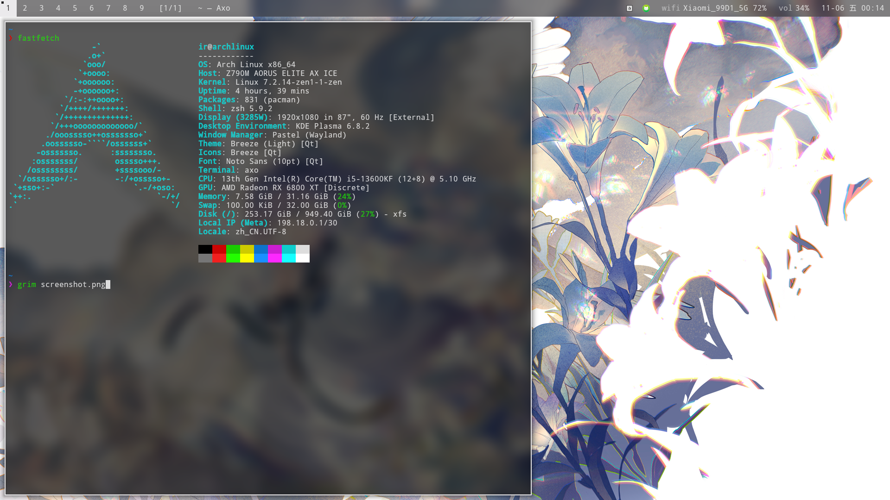
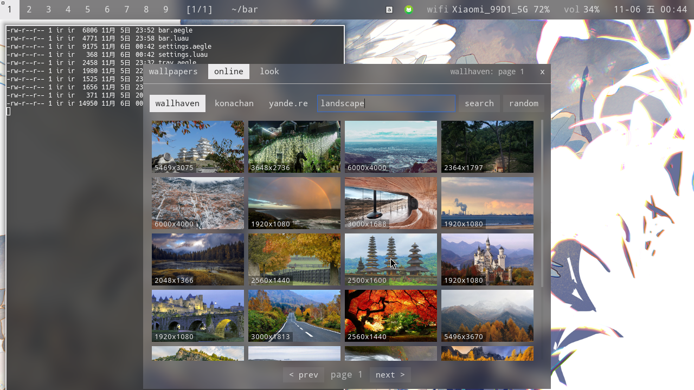
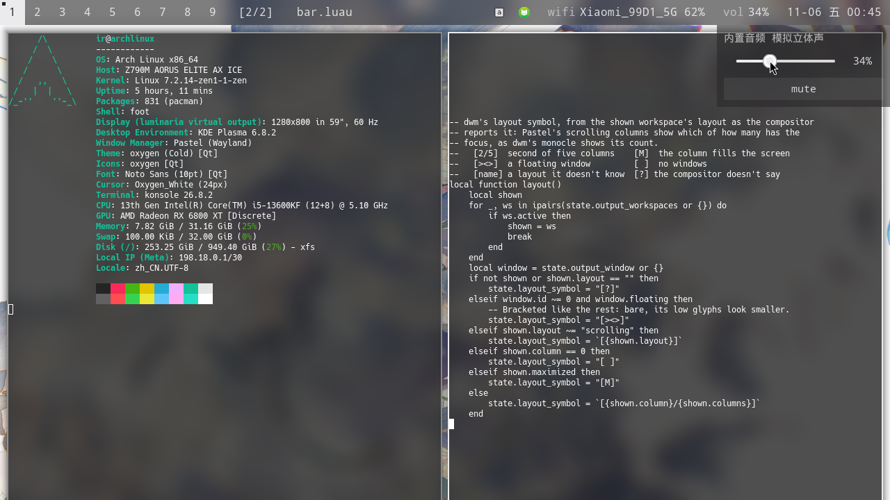

# bar

**English** · [简体中文](README.zh-CN.md)

A flat, translucent dwm-style bar for [Pastel](https://github.com/antinomie1/Pastel), written as [Palettes](https://github.com/antinomie1/Palettes) markup and Luau. It comes with a wallpaper layer and a settings panel that downloads wallpapers from Wallhaven, Konachan and yande.re; the bar, its popups and Pastel's window borders can all take their colors from the wallpaper.



<table>
  <tr>
    <td width="50%"></td>
    <td width="50%"></td>
  </tr>
  <tr>
    <td align="center">Wallpapers from Wallhaven, colors from the wallpaper</td>
    <td align="center">Layout symbol <code>[2/2]</code>, the volume popup</td>
  </tr>
</table>

## Features

- **dwm's layout**: square tags, marked when occupied and filled when they hold the focused window; the layout symbol, then the window title, then the tray and status on the right
- **Layout from the compositor**: Pastel's scrolling columns show as `[2/5]` (second of five), a maximized column as `[M]`, a floating window as `[><>]`, an empty workspace as `[ ]`
- **Status**: network (Wi-Fi strength, Ethernet, VPN), volume with a slider popup, Bluetooth, clock; dimmed when off
- **Tray**: StatusNotifierItem icons, bitmap ones shrunk to stay sharp; menus open one level at a time, long lists scroll, long entries end in `…`
- **Colors**: from Pastel's config, live on every save, or from the wallpaper (its average and most vivid color); Pastel can follow the wallpaper too, which rewrites only the colors in its `config.toml`
- **Wallpapers**: the wallpaper folder as cached thumbnails, a blur slider, and a search across Wallhaven, Konachan and yande.re (safe, landscape) with paging and a random pick; downloads keep going with the panel closed and show their progress
- **Settings panel**: drag it by any spot without a control; settings persist in `~/.config/bar/settings.json`, search words do not
- **Idle means idle**: no polling; previews download in parallel, thumbnails are made once, wallpapers past 4K are shrunk once when loaded

## Requirements

- [Palettes](https://github.com/antinomie1/Palettes) and [Pastel](https://github.com/antinomie1/Pastel). Other compositors with wlr-layer-shell work too, with tags through ext-workspace-v1 and no layout symbol (`[?]`)
- `curl`, `ffmpeg`, `vipsthumbnail` (libvips)
- The Hack font

## Running

```sh
git clone https://github.com/antinomie1/bar ~/bar
palettes ~/bar/bar.aegle
```

The bar opens the wallpaper layer itself. To start it with Pastel, and to bind the settings and a random wallpaper, in `~/.config/pastel/config.toml`:

```toml
autostart = ["palettes ~/bar/bar.aegle"]

[binds]
"Mod+S" = "spawn palettes msg toggle settings.aegle"
"Mod+W" = "spawn palettes msg random_wallpaper"
```

Saving any file reloads it in place.

## Using it

| Where | Left click | Right click |
|---|---|---|
| Tag | Show the workspace | Move the focused window there |
| Layout symbol | Open the settings | |
| Tray icon | Activate | Open its menu |
| `vol` | Volume slider | Mute |
| `bt` | Power Bluetooth on or off | |

In the settings: **wallpapers** sets one from the folder, **online** searches the three sites (a click downloads into the folder and sets it), **look** picks where colors come from, whether Pastel follows the wallpaper, and the bar's opacity.

## Files

| File | |
|---|---|
| `bar.aegle`, `bar.luau` | The bar; colors, labels and the layout symbol |
| `wallpaper.aegle`, `wallpaper.luau` | The wallpaper; settings, searching, downloads, colors from the wallpaper, Pastel's colors |
| `settings.aegle`, `settings.luau` | The settings panel |
| `tray.aegle`, `tray.luau` | Tray menus, one level at a time |
| `volume.aegle` | The volume popup |
| `ui.aegle` | Pieces the bar and panels share |

Downloads go to the wallpaper folder (`~/Pictures/Wallpapers` by default), thumbnails and previews to `~/.cache/bar`.
