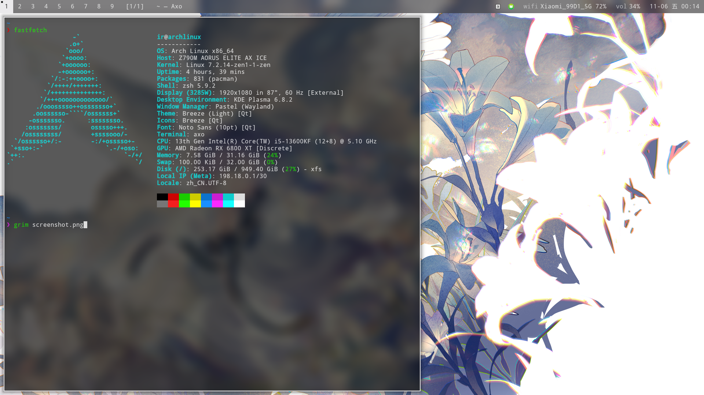
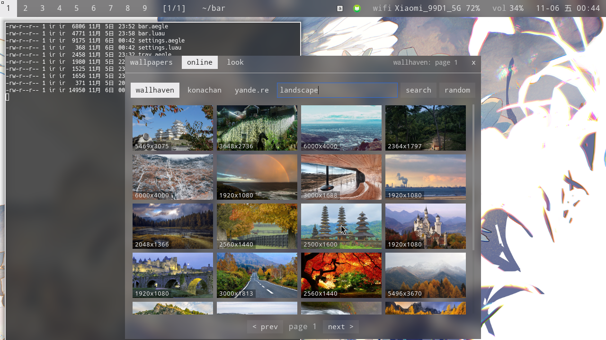
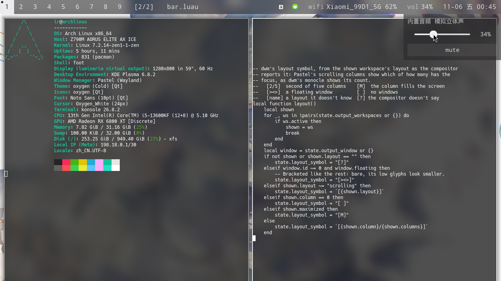
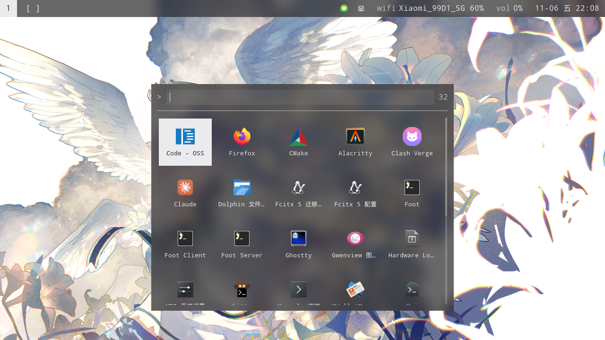

# bar

[English](README.md) · **简体中文**

为 [Pastel](https://github.com/antinomie1/Pastel) 写的扁平、半透明 dwm 风格状态栏，基于 [Palettes](https://github.com/antinomie1/Palettes) 的标记语言与 Luau。附带壁纸层与设置面板，可从 Wallhaven、Konachan、yande.re 下载壁纸；状态栏、弹出层与 Pastel 的窗口边框都能取壁纸的配色。



<table>
  <tr>
    <td width="50%"></td>
    <td width="50%"></td>
  </tr>
  <tr>
    <td align="center">来自 Wallhaven 的壁纸，配色取自壁纸</td>
    <td align="center">布局符号 <code>[2/2]</code>，音量弹出层</td>
  </tr>
  <tr>
    <td colspan="2" align="center"></td>
  </tr>
  <tr>
    <td colspan="2" align="center">应用程序：最近启动的在前，可搜索，方向键移动</td>
  </tr>
</table>

## 功能

- **dwm 布局**：正方形工作区标签，有窗口时标记、含焦点窗口时填实；随后是布局符号与窗口标题，右侧是托盘与状态
- **布局随混成器**：Pastel 的滚动列显示为 `[2/5]`（五列中的第二列），最大化的列为 `[M]`，浮动窗口为 `[><>]`，空工作区为 `[ ]`
- **状态**：网络（Wi-Fi 信号、以太网、VPN）、音量（点开滑条）、蓝牙、时钟；关闭时变暗
- **托盘**：StatusNotifierItem 图标，位图图标缩小后依然清晰；菜单逐级进入，长列表可滚动，过长条目以 `…` 结尾
- **配色**：取自 Pastel 配置（每次保存即时生效），或取自壁纸（平均色与最鲜艳的颜色）；Pastel 也可跟随壁纸，只改写其 `config.toml` 中的颜色
- **壁纸**：壁纸文件夹以缓存缩略图列出，可调模糊；在 Wallhaven、Konachan、yande.re（全年龄、横图）中搜索、翻页或随机一张；关闭面板后下载照常进行并显示进度
- **应用程序**：已安装的应用以图标网格列在居中面板中，最近启动的排在最前；直接打字即按名称与 desktop id 搜索（前缀匹配优先），方向键移动选中项，回车启动，Esc 关闭
- **设置面板**：按住任何非控件处即可拖动；设置保存在 `~/.config/bar/settings.json`，搜索词不保存
- **空闲即不耗资源**：不轮询；预览图并行下载，缩略图只生成一次，超过 4K 的壁纸加载时缩小一次

## 依赖

- [Palettes](https://github.com/antinomie1/Palettes) 与 [Pastel](https://github.com/antinomie1/Pastel)。其他支持 wlr-layer-shell 的混成器亦可，标签经 ext-workspace-v1 获取，布局符号显示为 `[?]`
- `curl`、`ffmpeg`、`vipsthumbnail`（libvips）
- Hack 字体

## 运行

```sh
git clone https://github.com/antinomie1/bar ~/bar
palettes ~/bar/bar.aegle
```

状态栏会自行打开壁纸层。随 Pastel 启动、并为应用程序、设置与随机壁纸绑定快捷键，在 `~/.config/pastel/config.toml` 中：

```toml
autostart = ["palettes ~/bar/bar.aegle"]

[binds]
"Mod+D" = "spawn palettes msg toggle apps.aegle"
"Mod+S" = "spawn palettes msg toggle settings.aegle"
"Mod+W" = "spawn palettes msg random_wallpaper"
```

保存任一文件即原地重载。

## 操作

| 位置 | 左键 | 右键 |
|---|---|---|
| 工作区标签 | 切换到该工作区 | 把焦点窗口移过去 |
| 布局符号 | 打开设置 | |
| 托盘图标 | 激活 | 打开菜单 |
| `vol` | 音量滑条 | 静音 |
| `bt` | 开关蓝牙 | |

设置中：**wallpapers** 从文件夹选壁纸，**online** 在三个站点搜索（点击即下载到文件夹并设为壁纸），**look** 选择配色来源、Pastel 是否跟随壁纸，以及栏的不透明度。

## 文件

| 文件 | |
|---|---|
| `bar.aegle`、`bar.luau` | 状态栏；配色、标签文字与布局符号 |
| `wallpaper.aegle`、`wallpaper.luau` | 壁纸；设置、搜索、下载、壁纸取色、Pastel 配色 |
| `settings.aegle`、`settings.luau` | 设置面板 |
| `tray.aegle`、`tray.luau` | 逐级进入的托盘菜单 |
| `apps.aegle`、`apps.luau` | 应用程序及其搜索 |
| `volume.aegle` | 音量弹出层 |
| `ui.aegle` | 状态栏与各面板共用的部件 |

下载保存在壁纸文件夹（默认 `~/Pictures/Wallpapers`），缩略图与预览图在 `~/.cache/bar`，启动过的应用记录在 `~/.local/state/bar/apps.json`。
